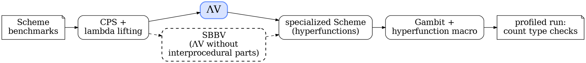

# ΛV Experimental Results {#lv-experiments-title layout=title}

# ΛV: Experimental Setup {#lv-setup .small}

Implemented source to source: Scheme in, specialized Scheme out, run on **Gambit**



::::: columns
::: column {width=1fr}
{.reveal}
:::: group
### 27 benchmarks

12 macro, over 400 lines

15 micro: `fib`, `tak`, `sum`...
::::
::: /column
::: column {width=1fr}
{.reveal}
:::: group
### 60 configurations

3 heuristics, 2 operator forms

Version limit 1 to 10
::::
::: /column
::: column {width=1fr}
{.reveal}
:::: group
### 3 measures

Type checks executed

Compile time, code duplication
::::
::: /column
:::::

::: detour {#lv-no-time label="Why no execution time?" key=e}
# Why No Execution Time? {#lv-no-time-slide .small}

::: columns
::: column {width=1fr}
{#hf-points .reveal}
- **Multi-return functions** through CPS: one continuation per return point
- **No native implementation** of hyperfunctions: a Scheme macro emulates them, slower than the source program
::: /column
::: column {width=1fr}
```code {#hf-code lang=racket file="programs/hyperfunction-square.scm" title="square, calling * as a hyperfunction"}
```
::: /column
::: /columns

```arrow {#hf-arrow}
steps:
  - null
  - {from: "hf-points[1]", from_anchor: bottom, to: hf-code, to_anchor: left}
  - null
```

```timeline
reveal 1, hf-arrow 1     # first bullet, arrow to the hyperfunction
reveal 2, hf-arrow 2     # second bullet, arrow gone
```

::: /detour

::include{file="plots/lv-typechecks.md"}
::include{file="plots/lv-compile-time.md"}
::include{file="plots/lv-versions.md"}
