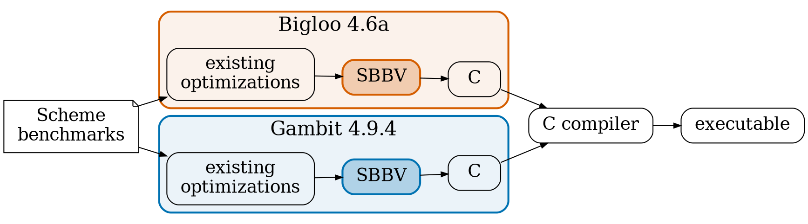

# SBBV Experimental Results {#sbbv-experiments-title layout=title}

# SBBV: Experimental Setup {#sbbv-setup .small}

Implemented in two production-ready Scheme compilers: **Bigloo** and **Gambit**



::::: columns
::: column {width=1fr}
{.reveal}
:::: group
### 19 benchmarks

12 macro, up to 11,740 lines

7 micro: `fib`, `tak`, `ack`...
::::
::: /column
::: column {width=1fr}
{.reveal}
:::: group
### 8 configurations

No SBBV: own optimizations

Version limit 1 to 5, 10, 20
::::
::: /column
::: column {width=1fr}
{.reveal}
:::: group
### 4 measures

Dynamic checks, program size

Execution and compile time
::::
::: /column
:::::

::: detour {#sbbv-context label="Already fast?" key=f}
# Bigloo and Gambit Are Already Fast {#sbbv-context-table .small}

Execution time in seconds, SBBV with a limit of 2 versions (highlighted: fastest)

```table-steps
best: min
table: |
  | Program     | Node.js | Bigloo | Bigloo + SBBV | Gambit | Gambit + SBBV | Chez  | Racket |
  |-------------|--------:|-------:|--------------:|-------:|--------------:|------:|-------:|
  | `almabench` | 6.31    | 15.68  | 14.46         | 14.64  | 13.86         | 17.69 | 19.30  |
  | `boyer`     | 40.31   | 7.40   | 7.22          | 8.21   | 6.49          | 8.09  | 12.38  |
  | `earley`    | 56.75   | 14.90  | 13.83         | 10.87  | 10.34         | 9.53  | 24.73  |
  | `leval`     | 18.42   | 7.53   | 6.47          | 12.03  | 9.74          | 7.16  | 16.96  |
  | `maze`      | 10.07   | 7.47   | 6.70          | 6.75   | 5.73          | 12.01 | 12.12  |
  | `bague`     | 305.04  | 12.90  | 11.19         | 15.54  | 12.93         | 21.01 | 19.33  |
steps:
  - hide: [Bigloo + SBBV, Gambit + SBBV]
  - show: [Bigloo + SBBV, Gambit + SBBV]
```

::: /detour

::include{file="plots/sbbv-checks.md"}
::include{file="plots/sbbv-size.md"}
::include{file="plots/sbbv-time.md"}
::include{file="plots/sbbv-compile-time.md"}
